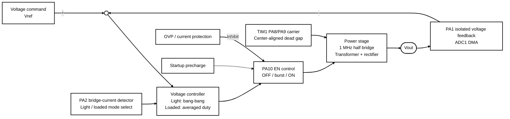

# Digest Control-System Diagram

This figure summarizes the G071 `PWR-1.9.20` baseline as a conventional
closed-loop voltage-control system. The detailed implementation diagram remains
in [firmware-flow.md](firmware-flow.md).

The F410 port retains this control structure with different peripheral pins;
see [STM32F410 port notes](stm32f410-port.md).

Exports: [PNG](firmware-flow-distilled.png) | [SVG](firmware-flow-distilled.svg)

PA1 closes the voltage-control loop. PA2 measures half-bridge current only and
selects light-load or loaded behavior; it is not secondary-output-current
feedback. Protection can override the controller and force PA10 EN off.
