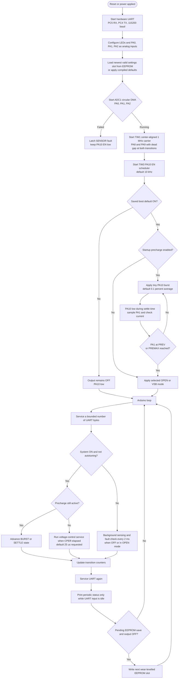
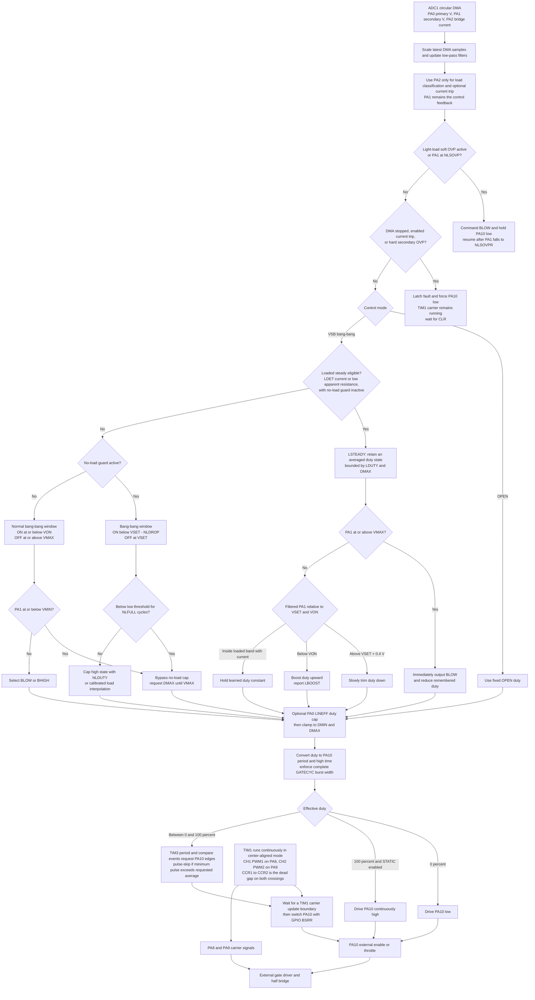

# G071 Baseline Firmware Flow

This diagram describes the G071 baseline, version `PWR-1.9.20`, from which the
current [`thesi_power_control.ino`](../thesi_power_control.ino) was ported.
It documents the implemented behavior; it is not a proposed control scheme.

For the `PWR-2.0.0` F410 pin assignments and hardware changes, see
[STM32F410 port notes](stm32f410-port.md).

PNG export: [firmware-flow.png](firmware-flow.png)

## Boot And Main Loop

## Voltage Control And EN Generation

## Important Boundaries

- PA1 secondary voltage is the closed-loop control signal.
- PA2 measures half-bridge current. It classifies light versus loaded operation and
  can trip protection when explicitly enabled; it is not secondary output-current
  feedback.
- PA0 affects duty only when optional `LINEFF` is enabled.
- The active controller is voltage bang-bang plus loaded steady-duty trim. Legacy
  power-loop fields remain in the settings structure for compatibility, but they do
  not form an active power-control loop.
- ADC reads in live control come only from the circular DMA buffer.
- UART work is byte-budgeted, and EEPROM writes are deferred until the output is
  off, preventing command handling or flash writes from blocking active switching.
