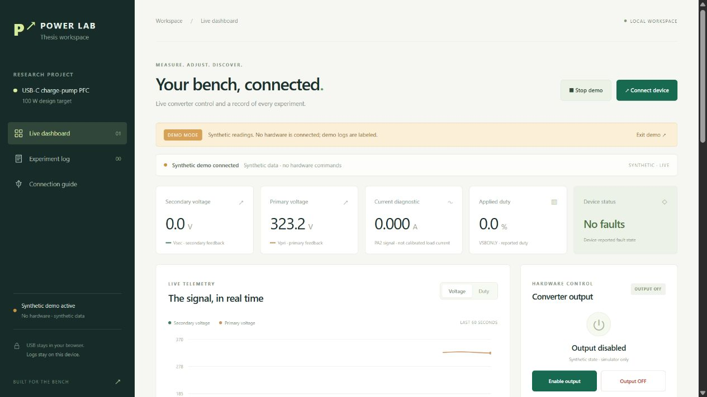
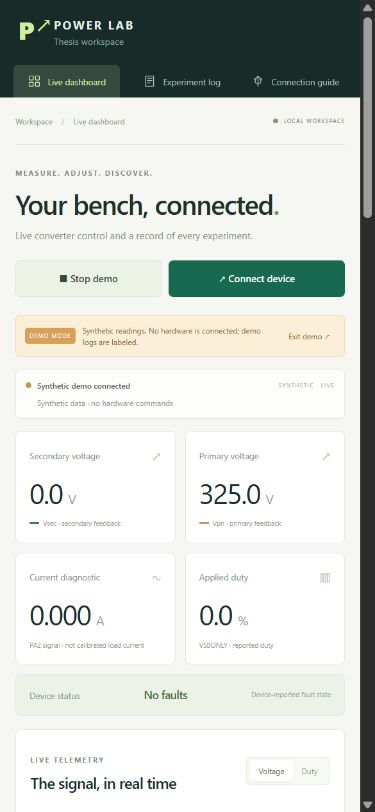

# Power Lab verification — October 19, 2026

## Bench interface revision

The redesigned interface uses compact desktop controls, a dark dual-axis voltage
scope, a parameter list beside acquisition, and a native session table. Display
code and styling changed; the USB transport, firmware and local storage format
remain compatible. All 25 existing tests pass. Browser QA applied and explicitly
saved a setting, ran ON/OFF in synthetic Demo, recorded 62 samples, and exported
62 CSV rows marked `demo` / `SIMULATED`. Existing saved runs remained visible in
the table. No browser errors/warnings were captured.

At 1280 by 800, Apply and the recorder action are both within the first screen.
At the 390-pixel mobile viewport, the document has no horizontal overflow and
parameter inputs render at 16 pixels. The log table scrolls within its own panel.
Both voltage scales and the synthetic source are explicitly labeled. This
revision was published after explicit user approval as deployment
`dpl_FdqNs3i86KAZQuUFZcH8ivEcJFVH`. It reached READY; all six public app assets
match local SHA-256 hashes. The live browser loaded the redesigned interface
and exercised Demo/ON without captured errors or warnings. Evidence is saved in
`qa/instrument-deployment-check.json` and `qa/instrument-live.jpg`.

## Verified behavior

The application is a static browser UI that connects directly to the existing
UART through Web Serial and saves experiments in the browser. Its real USB
transport was exercised with a simulated serial port, then its visible control
and logging workflow was exercised in the browser using explicitly synthetic
Demo data. No physical port was opened and no board was flashed or powered.

| Check | Result |
| --- | --- |
| Node control/protocol/export tests | 25 passed |
| Static build | Six app files generated successfully in `dist/` |
| Browser page | HTTP 200 with JavaScript modules and app security headers |
| Initial state | Measurements empty; hardware controls disabled |
| Demo controls | ON/OFF, VSET apply, explicit device SAVE while OFF |
| Recording | 67 synthetic samples captured in a 33-second run |
| IndexedDB | Saved run present after page reload |
| CSV download | 67 rows, source `demo`, firmware `SIMULATED`, timestamps and units verified |
| JSON download | Metadata and 67 samples verified |
| Operator audit trail | Second synthetic run exported ON/OFF commands and both successful acknowledgments |
| Responsive layout | Desktop and 390-by-844 mobile viewport inspected; no horizontal overflow |
| Browser errors | No captured errors or warnings during control/logging tests |
| Firmware host harness | 46 JSON frames passed against extracted production protocol code |
| F410 build | 85,184 / 98,304 flash; 6,820 / 32,768 static RAM |
| G071 build | 127,340 / 131,072 flash; 9,524 / 32,768 static RAM |
| F410 HEX layout | Record checksums/vectors valid; reserved settings sector excluded |
| Vercel production | READY; public URL loads without authentication; all six assets match local SHA-256 |
| Published browser test | Disconnected state and Demo verified; no captured errors or warnings |

The 25 browser-side tests include partial serial chunks, CR/LF framing, oversized
input recovery, invalid JSON, strict telemetry leases, command injection,
handshake/lease setup, correlated acknowledgement/rejection/timeout, no automatic
mutation retry, stale/fault interlocks, OFF canceling queued work, disconnect/ON
races, port chooser cancellation, unplug, synthetic isolation, explicit SAVE,
and CSV quoting/formula handling. The transport tests use real Web Streams with
an in-memory serial device.

Firmware test details and the physical verification boundary are in
[`docs/web-protocol.md`](../docs/web-protocol.md). G071 has only **3,732 bytes**
of program space remaining. Flash usage alone does not measure runtime stack
headroom or control-loop timing under load.

## Reproduce

```powershell
cd C:\Users\multi\Documents\Thesis\web
node --test tests/*.test.mjs
node build.mjs
```

```powershell
cd C:\Users\multi\Documents\Thesis
python firmware/test_web_protocol.py
python firmware/verify_f410_hex.py arduino-build-f410-web/thesi_power_control.ino.hex
```

The host harness needs the installed Visual Studio C++ Build Tools. Arduino
builds use STM32 Arduino core 2.8.1 and `firmware/build.ps1` with fresh build
directories. The generated sketches were checked to contain the new protocol.

## Deployment and remaining checks

Published after explicit user approval at **https://thesis-power-lab.vercel.app**.
Deployment `dpl_9VeXjur2mSbAwBxyFXVhdHurTMmP` reached READY. Anonymous HTTPS
requests returned the actual app and all six application files matched the local
SHA-256 hashes; this was not a Vercel login/protection page. The live browser
then loaded the app and ran synthetic Demo without captured errors/warnings.
Details are retained in `qa/deployment-check.json` and `deployment.json`.

The payload consisted only of the six app files, `package.json`, `build.mjs`,
and `vercel.json`; no thesis documents, session data, credentials, or firmware
source were uploaded. Initial automatic approval review required explicit
authorization for that source and destination; publication proceeded after the
user approved it. Some saved `danishoffice` management endpoints, including
build-log retrieval, returned 403. The actual READY result, public HTTPS asset
comparison, and live browser test establish the deployment result independently.

Real USB adapter enumeration, board command/ack timing, lease behavior with the
actual firmware, ADC scaling against instruments, populated divider values,
control-loop timing, and electrical protection behavior still require the
appropriately isolated bench setup. The firmware communication lease is loop
serviced; it is not an independent hardware watchdog or emergency stop.

Browser storage is origin-specific. Localhost sessions will not automatically
appear at a future Vercel URL. Exports provide an independent record.

## Preview evidence





## Resonance calculator revision — October 19, 2026

Local verification completed for the integrated calculator:

- 46 Node tests passed: the original 25 protocol/transport/storage tests plus
  17 mathematics and four source-preset checks. Eleven static app files built.
- Browser solves: 9.4 + 16.5 µH with 1 nF gives 988.9 kHz. At 1 MHz,
  required discrete L = 8.83 µH or equivalent C = 978 pF.
- Two 2 nF entries give 1 nF in series and 4 nF in parallel, with corresponding
  resonances 988.9 and 494.5 kHz. Entering R = 50 Ω gives Q = 3.219 and
  bandwidth 307.2 kHz, with a normalized series-current plot.
- The latest F410 drawing preset leaves C26 and leakage blank. Missing C26
  prevents frequency solving and export; selecting C as unknown solves it.
  Blank leakage is explicitly labeled an assumed zero. An impossible negative
  discrete-L requirement produces an error and disables export.
- Separate pump solves Lp = 31.25 µH for 2 nF / 1 MHz, with natural fp =
  636.6 kHz. Cp and switching-frequency solves were also checked in the browser.
- Downloaded JSON, CSV (24 rows), and pump JSON were read and verified against
  the calculation inputs, results, source references, and assumptions. With no
  switching frequency, exported operating-point values remain null.
- Desktop and 390 × 844 layouts inspected. No page overflow or captured
  browser errors/warnings. Screenshots: `qa/calculator-desktop.png`,
  `qa/calculator-mobile-inputs.png`, `qa/calculator-mobile-results.png`.
- The monitor's calculator link opens a separate tab, preserving the monitor
  and its USB/logging connection. The calculator imports no USB transport.

Browser evidence: `qa/calculator-browser-check.json`. Source evidence:
[`docs/calculator-evidence.md`](../docs/calculator-evidence.md).
The fourteen-file release manifest excludes source PDFs, firmware, sessions,
credentials, tests, and QA artifacts. Production verification is recorded below
after release; the original USB electrical verification boundary still applies.


### Calculator production verification

Published after the user's explicit approval, “Publish the calculator.”
Deployment `dpl_G2ybAVuksqV4L8nWyxrQSdu3ngX8` reached READY and owns
`thesis-power-lab.vercel.app`. All eleven public application files returned
HTTP 200 with correct content types and matched the approved raw SHA-256 hashes.
The fourteen-file upload preserved exact source-file bytes, including line endings.

The public browser page solved f = 988.9 kHz, discrete L = 8.83 µH, and
C = 978 pF. The latest drawing's missing C26 produced the expected error and
disabled export. No captured browser errors or warnings. Source PDFs, firmware,
and recorded sessions were excluded. The calculator is available at
<https://thesis-power-lab.vercel.app/calculator.html>.

Evidence: `qa/calculator-deployment-check.json`,
`qa/calculator-live-browser-check.json`, `qa/calculator-live.png`.

## UI refinement — October 24, 2026

The monitor and calculator received a coordinated typography, spacing,
contrast, mobile navigation, keyboard focus, and field-validation pass.
The calculator now retains the selected result while editing on mobile.
See [`UI-REVIEW.md`](UI-REVIEW.md) for the scope and evidence boundaries.

All 46 existing tests passed; eleven static application files built.
Demo capture/export, edited calculator export, keyboard destinations, and
320/390 px layouts passed local browser checks. Navigation also passed
Sessions → Connection → top-of-page checks on a short desktop layout.

Production deployment `dpl_A7MtyB1g2BG2ez49kqRLsKCHqAtD` is READY at
<https://thesis-power-lab.vercel.app>. All eleven public files returned HTTP
200 and matched the source SHA-256 hashes. The live calculator's three modes
returned 988.9 kHz, 8.83 µH, and 978 pF. Its 320 px layout had no horizontal
overflow and retained the selected answer. The live monitor displayed synthetic
readings, then its simulator was stopped. No captured browser warnings/errors.
Firmware, source PDFs, recorded sessions, credentials, tests, and QA files
were excluded from the fourteen-file upload. Real USB behavior was not tested.

Evidence: `qa/skills-ui-check.json`, `qa/skills-ui-deployment-check.json`,
`qa/skills-ui-live-browser-check.json`, and `qa/skills-ui-live-*.png`.
